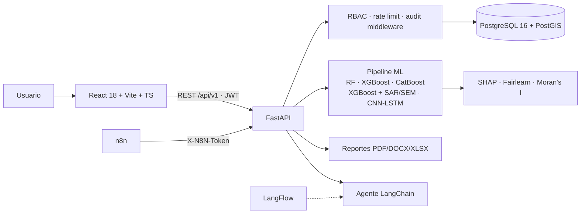

# NutriRisk AI

## Predicción del riesgo de desnutrición infantil con datos públicos reales

La entrada principal de la web presenta el sistema de **predicción de desnutrición infantil** entrenado con datos reales del Banco Mundial y UNICEF/OMS/Banco Mundial (JME): **161 países, 9 determinantes socioeconómicos y ambientales, 350 ensayos de optimización y 35 ajustes exteriores** bajo validación Leave-One-Region-Out en 2023.

- [Artículo científico en PDF (23 páginas)](entregables/Articulo_NutriRisk_Datos_Reales.pdf)
- [Artículo científico en Word (.docx)](entregables/Articulo_NutriRisk_Datos_Reales.docx)
- [Informe completo de entrenamiento, pruebas e hiperparámetros](entregables/Informe_Entrenamiento_Datos_Reales.md)
- [Procedencia y manifiesto del dataset público](data/real/manifest.json)
- [Dataset consolidado (CSV)](data/real/country_panel.csv)

Inicio de la aplicación: `powershell -ExecutionPolicy Bypass -File scripts/run_real_web.ps1`. Abrir [http://127.0.0.1:8000/investigacion](http://127.0.0.1:8000/investigacion).

La documentación siguiente describe la plataforma y su demostración histórica. **El país ficticio, los registros infantiles y el mapa sintético no forman parte del estudio real.** Estos módulos se conservan separados y etiquetados. Para reproducir el experimento vigente, usar el informe y `backend/scripts/train_real.py`; el pipeline histórico de abajo no lo sustituye.

**Predicción explicable del riesgo de desnutrición infantil integrando determinantes socioeconómicos, nutricionales y ambientales.**

Aplicación web completa (API + interfaz + pipeline de machine learning + orquestación) que implementa el proyecto de tesis
*“Explainable AI for Childhood Malnutrition Risk Prediction Integrating Socioeconomic, Nutritional and Environmental Determinants”* (Tema SP-08).

> ⚠️ **Datos de demostración sintéticos.** La instalación incluye un país ficticio (*República de Andara*), 24 territorios y
> 14.400 niños generados por el propio sistema. **No representan prevalencias reales.** Todo registro sintético queda
> etiquetado (`is_synthetic = true`, `source = SYNTHETIC`) y se advierte en la interfaz. El pipeline está preparado para
> cargar microdatos DHS, World Bank, UNICEF y capas WorldPop con el mismo flujo de ingesta.

---

## 1. Qué resuelve

| Necesidad | Cómo se atiende |
|---|---|
| Identificación temprana de niños en riesgo | Modelo de clasificación con 26 determinantes (socioeconómicos, WASH, dietéticos, ambientales) |
| Priorización territorial de intervenciones | Mapa coroplético de riesgo, ranking de territorios y población menor de 5 años en riesgo |
| Transparencia y confianza | SHAP global, local (por niño) y agregado por territorio, con narrativa en español |
| Equidad | Métricas por sexo, quintil de riqueza, área urbano/rural y región (Fairlearn) |
| Transferibilidad espacial | Validación GroupKFold por región y leave-one-region-out, Moran's I de residuos, SAR/SEM/GWR |
| Rendición de cuentas | Bitácora inmutable con entrada/salida por módulo, IP, user-agent y resultado |
| Operación institucional | Reportes PDF/Word/Excel, alertas, programación con n8n y agente conversacional LangChain |

## 2. Stack

| Capa | Tecnología |
|---|---|
| Backend | Python 3.11 · FastAPI · Pydantic v2 · SQLAlchemy 2 · Alembic · Uvicorn |
| Base de datos | PostgreSQL 16 + PostGIS 3.4 (Docker) · SQLite (modo demostración local) |
| ML | scikit-learn · XGBoost · CatBoost · PyTorch (CNN-LSTM) · SHAP · Fairlearn · statsmodels · PySAL (esda, spreg) |
| Frontend | React 18 · Vite · TypeScript · TanStack Query · Recharts · Leaflet/react-leaflet |
| Orquestación | n8n · LangChain · LangFlow |
| Reportes | ReportLab (PDF) · python-docx (Word) · openpyxl/XlsxWriter (Excel) |
| Infraestructura | Docker Compose (db, api, web, n8n, langflow) |

## 3. Arquitectura



Detalle completo (ER en Mermaid, estructura del monorepo y flujo de datos): [`docs/ARQUITECTURA.md`](docs/ARQUITECTURA.md).

## 4. Estructura del repositorio

```
nutririsk-ai/
├── backend/                 API FastAPI, pipeline ML, migraciones, pruebas
│   ├── app/                 api/v1 · core · db · ml · models · schemas · services · middleware
│   ├── alembic/             migraciones (esquema + inmutabilidad de bitácora)
│   ├── scripts/             seed · train_pipeline · refresh_explanations · smoke_test
│   ├── tests/               pytest (81 % de cobertura)
│   └── data/reference/      tablas LMS OMS 2006
├── frontend/                React 18 + Vite + TypeScript (16 vistas)
├── data/synthetic/          CSV, GeoJSON y diccionario de datos sintéticos
├── n8n/workflows/           3 flujos exportados (.json)
├── langflow/                flujo RAG exportado (.json)
├── notebooks/               EDA reproducible
├── docs/                    arquitectura, modelo (model card), decisiones
├── infra/db/                extensión PostGIS e índices
├── docker-compose.yml       despliegue completo
├── .env.example             variables de entorno
├── Makefile                 comandos de conveniencia
├── README.md · DECISIONES.md · MANUAL_USUARIO.md · DICCIONARIO_DATOS.md
```

## 5. Inicio rápido con Docker (un solo comando)

```bash
cp .env.example .env        # ajuste SECRET_KEY y contraseñas
docker compose up --build -d
```

| Servicio | URL | Credenciales |
|---|---|---|
| Aplicación web | http://localhost:8080 | ver tabla de usuarios demo |
| API + Swagger | http://localhost:8000/docs | — |
| n8n | http://localhost:5678 | `admin` / `nutririsk2026` |
| LangFlow | http://localhost:7860 | autologin |
| PostgreSQL/PostGIS | `localhost:5432` | `nutririsk` / `nutririsk` |

El contenedor `api` ejecuta, en el primer arranque: `alembic upgrade head` → seed de datos sintéticos → entrenamiento de
Random Forest, XGBoost, CatBoost, XGBoost espacial y CNN-LSTM → cálculo de SHAP y mapa de riesgo. Puede tardar **3-6 minutos**
en el primer arranque (descarga de imágenes y entrenamiento). Progreso: `docker compose logs -f api`.

### Usuarios de demostración

| Rol | Correo | Contraseña |
|---|---|---|
| Administrador | `admin@nutririsk.ai` | `Admin#2026!` |
| Científico de datos | `cientifico@nutririsk.ai` | `Ciencia#2026!` |
| Analista de salud pública | `analista@nutririsk.ai` | `Analista#2026!` |
| Gestor / Decisor | `gestor@nutririsk.ai` | `Gestor#2026!` |
| Auditor (solo lectura) | `auditor@nutririsk.ai` | `Auditor#2026!` |

## 6. Ejecución local (sin Docker, modo demostración)

Requiere Python 3.11+, Node.js 20+ y ~2,5 GB de dependencias (PyTorch incluido).

```bash
# 1) Backend
python -m venv .venv
.venv/Scripts/python -m pip install -r backend/requirements-dev.txt
.venv/Scripts/python -m pip install -r backend/requirements-torch.txt   # CNN-LSTM (opcional)

cd backend
../.venv/Scripts/python -m alembic upgrade head      # esquema + triggers de inmutabilidad
../.venv/Scripts/python -m scripts.seed --regenerate  # datos sintéticos + ingesta
../.venv/Scripts/python -m scripts.train_pipeline --algorithms random_forest xgboost catboost spatial_xgboost --include-cnn
../.venv/Scripts/python -m scripts.refresh_explanations
../.venv/Scripts/python -m uvicorn app.main:app --host 127.0.0.1 --port 8000
```

```bash
# 2) Frontend (otra terminal)
cd frontend
npm install
npm run build        # genera frontend/dist
# La API sirve automáticamente frontend/dist en http://127.0.0.1:8000
# Alternativa de desarrollo con recarga: npm run dev (http://127.0.0.1:5173)
```

Sin `DATABASE_URL`, la aplicación usa `backend/data/nutririsk.db` (SQLite) para que la demostración funcione sin
infraestructura. En Docker se usa PostgreSQL 16 + PostGIS.

**Variables de entorno principales** (ver `.env.example`): `SECRET_KEY`, `DATABASE_URL`, `CORS_ORIGINS`, `DEMO_MODE`,
`AUTO_SEED`, `SEED_TRAIN`, `LLM_PROVIDER`/`OPENAI_API_KEY`, `N8N_WEBHOOK_TOKEN`, `INSTALL_TORCH`.

## 7. Datos sintéticos de demostración

* **País ficticio**: República de Andara, 24 departamentos hexagonales, 5 regiones (Norte, Centro, Sur, Oriente, Occidente).
* **Periodo**: 2021-2023, 200 niños por territorio y año → **14.400 registros**.
* **Generación**: modelo latente de crecimiento calibrado con coeficientes por determinante; las mediciones se obtienen
  **invirtiendo las curvas LMS de la OMS 2006**, de modo que los z-scores calculados sean internamente consistentes.
* **Prevalencias resultantes** (semilla 42): retraso del crecimiento **18,7 %**, emaciación **6,9 %**, bajo peso **9,9 %**,
  con variación territorial de 7 % a 35 % — coherente con rangos documentados por la OMS.
* **Artefactos**: `data/synthetic/children_synthetic.csv`, `territories.geojson`, `territories_synthetic.csv`,
  `dataset_dictionary.json`, `manifest.json`.

Regeneración reproducible: `python -m app.services.synthetic` (semilla fija `42`).

## 8. Metodología de modelado

**Unidad de análisis**: niño (configurable a hogar o territorio en el catálogo de datasets).

**Variables (26)**: edad, sexo, quintil de riqueza, educación materna (años), edad materna, agua mejorada, saneamiento
mejorado, electricidad, activos, tamaño del hogar, inseguridad alimentaria del hogar, área urbana, dieta mínima diversa,
vacunación completa, diarrea y fiebre recientes, peso al nacer, lactancia, altitud, precipitación, temperatura, NDVI,
cobertura de agua y saneamiento del territorio, inseguridad alimentaria territorial y densidad de menores de 5 años.
**Nunca se usan variables antropométricas como predictoras** (evita fuga de información y permite el tamizaje previo a la medición).

**Algoritmos**: Random Forest, XGBoost, CatBoost, híbrido *XGBoost + regresión espacial* (rezagos de covariables vecinas y
calibración SAR de residuos) y **CNN-LSTM** (secuencias anuales por territorio).

**Validación**: `GroupKFold` agrupado por región (5 pliegues) y *leave-one-region-out*; el CNN-LSTM se evalúa con partición
por territorio y prueba de estrés LORO.

**Métricas**: AUC-ROC, F1 (umbral 0,5 y umbral óptimo), precisión, recall, exactitud, Brier, log-loss, RMSE, MAE, R² y
**Moran's I de residuos**; SAR/SEM (rho, lambda, pseudo-R²) y GWR (R² local) a nivel territorial.

**Explicabilidad**: SHAP con `TreeExplainer`; los valores se expresan en **puntos porcentuales de riesgo** mediante una
transformación logística secuencial (aditiva y exacta en el total), lo que hace comparables XGBoost/CatBoost con Random Forest.

**Resultados de referencia** (demostración sintética, semilla 42; los valores vigentes se consultan en *Modelos*):

| Modelo | AUC | F1 (óptimo) | Recall (tamizaje) | RMSE | R² |
|---|---|---|---|---|---|
| Random Forest | 0,776 | 0,481 | 0,750 | — | — |
| XGBoost | 0,774 | 0,479 | 0,750 | — | — |
| CatBoost | 0,771 | 0,478 | 0,751 | — | — |
| XGBoost + espacial | 0,744 | 0,445 | 0,750 | — | — |
| CNN-LSTM (prevalencia territorial) | — | — | — | 0,066 | 0,500 |

Moran's I de residuos no resulta significativo (p > 0,05): los determinantes observables capturan la estructura espacial
disponible en los datos sintéticos. Los umbrales operativos se seleccionan maximizando F1 y, para tamizaje, con recall ≥ 0,75.

## 9. Roles y permisos (RBAC)

| Módulo | Administrador | Científico | Analista | Gestor | Auditor |
|---|---|---|---|---|---|
| Tablero / mapa / territorios | ✅ | ✅ | ✅ | ✅ | 👁 |
| Indicadores OMS | ✅ | ✅ (+recalcular) | ✅ (+recalcular) | 👁 | 👁 |
| Datasets e ingesta | ✅ | ✅ | 👁 | 👁 | 👁 |
| Experimentos y modelos | ✅ | ✅ | 👁 | 👁 | 👁 |
| XAI / equidad | ✅ | ✅ (+ejecutar) | 👁 | — | 👁 |
| Reportes | ✅ | ✅ | ✅ | ✅ | 👁 (+exportar) |
| Bitácora | ✅ | 👁 | — | — | 👁 (+exportar) |
| Usuarios y configuración | ✅ | — | — | — | — |
| Agente conversacional | ✅ | ✅ | ✅ | ✅ | — |

✅ lectura/escritura · 👁 solo lectura · — sin acceso. La matriz se siembra en `role_permissions` y se expone en
`GET /api/v1/users/permissions`.

## 10. API

Documentación interactiva: **http://localhost:8000/docs** (OpenAPI 3.1, 98 rutas). Prefijo `/api/v1`.

| Grupo | Rutas principales |
|---|---|
| Autenticación | `POST /auth/login` · `/auth/refresh` · `/auth/logout` · `GET/PATCH /auth/me` · `/auth/change-password` · `/auth/forgot-password` · `/auth/reset-password` |
| Usuarios y roles | `GET/POST /users` · `PATCH/DELETE /users/{id}` · `/users/roles` · `/users/permissions` |
| Bitácora | `GET /audit/logs` · `/audit/summary` · `/audit/navigation` (GET/POST) · `/audit/export?fmt=pdf\|docx\|xlsx` |
| Datasets | `GET /datasets` · `POST /datasets/upload` · `/datasets/{id}/quality` · `/variables` · `/preview` · `/template` |
| Ingesta | `GET /ingestion/runs` · `POST /ingestion/trigger` · `POST /ingestion/n8n/sync` |
| Indicadores | `GET /indicators/summary` · `/children` · `/distribution` · `/reference` · `POST /indicators/recompute` |
| Modelado | `GET /experiments` · `POST /experiments/train` · `/experiments/{id}/regions` · `GET /experiments/compare` |
| Modelos | `GET /models` · `/models/active` · `/comparison` · `POST /models/{id}/activate` · `/score` |
| XAI | `GET /xai/global` · `/xai/child/{id}` · `/xai/territory/{id}` · `/xai/dependence?feature=` |
| Equidad | `GET /fairness/{model_id}` · `POST /fairness/run` · `/fairness/attributes` |
| Cartografía | `GET /geo/map` · `/geo/ranking` · `/geo/territories/{code}` · `/geo/layer/{code}` · `/geo/risk-distribution` |
| Tablero | `GET /dashboard/overview` · `/kpis` · `/trends` · `/comparison` · `/options` |
| Reportes | `GET /reports/kinds` · `POST /reports/generate` · `GET /reports/{id}/download` · `POST /reports/n8n/generate` |
| Alertas | `GET/POST /alerts` · `/alerts/summary` · `/alerts/evaluate` · `POST /alerts/{id}/acknowledge\|resolve` |
| Agente | `POST /agent/chat` · `/agent/sessions` · `GET /agent/capabilities` |
| Sistema | `GET /system/health` · `/system/info` · `/system/monitoring` · `POST /system/demo-data` |

**Seguridad**: JWT de acceso (60 min) + refresh (7 días) con rotación y revocación; Argon2id (bcrypt heredado soportado);
bloqueo tras 5 intentos fallidos; rate limiting por IP; CORS restrictivo; cabeceras OWASP; validación Pydantic; bitácora
inmutable a nivel de base de datos; anonimización de identificadores con sal.

## 11. Reportes y exportaciones

Seis tipos × tres formatos (PDF, Word, Excel): ficha de riesgo territorial, ranking de priorización, desempeño de modelos,
informe de equidad, bitácora de auditoría y resumen de prevalencias. `POST /api/v1/reports/generate` devuelve el reporte y
`GET /api/v1/reports/{id}/download` el archivo. La bitácora se exporta en los tres formatos respetando permisos.

## 12. Orquestación: n8n y LangFlow

* `n8n/workflows/01_ingesta_programada.json` — cron diario → `POST /ingestion/n8n/sync` → notificación de incidencias.
* `n8n/workflows/02_alertas_riesgo.json` — cron diario → `POST /alerts/n8n/evaluate` → correo si hay alertas nuevas.
* `n8n/workflows/03_reportes_programados.json` — cron mensual → `POST /reports/n8n/generate` → descarga y envío.
* Los tres usan el encabezado `X-N8N-Token` (servicio a servicio, sin JWT de usuario) definido en `.env`.
* Importación: n8n → *Workflows* → *Import from File*. Configure las credenciales SMTP y las variables
  `NUTRIRISK_API_URL`, `NUTRIRISK_API_TOKEN`, `NUTRIRISK_WEB_URL`.
* `langflow/nutririsk_rag_flow.json` — prototipo RAG (ChatInput → Prompt con contexto → LLM → ChatOutput + herramienta HTTP
  hacia la API). Importar en LangFlow 1.x desde *Projects → Import*.

## 13. Pruebas y calidad

```bash
cd backend
../.venv/Scripts/python -m pytest --cov=app --cov-report=term-missing
```

* **Cobertura**: 81 % (objetivo ≥ 70 %). Incluye antropometría OMS, seguridad, RBAC, ingesta/QC, API completa,
  modelado, estadística espacial, inmutabilidad de bitácora y generador sintético.
* **Smoke test E2E** contra una instancia en ejecución: `python scripts/smoke_test.py http://127.0.0.1:8000` (59 comprobaciones:
  login, dashboard, mapa, SHAP, equidad, reportes en 3 formatos, RBAC del auditor, agente, n8n).
* **Linting**: `ruff check app tests scripts` (backend) y `eslint` (frontend).
* **Tipado**: `tsc --noEmit` estricto en el frontend; anotaciones tipadas en todo el backend.

## 14. Reproducibilidad

* Semilla global fija (`RANDOM_SEED=42`) en generación sintética, particiones, modelos y PyTorch.
* Artefactos versionados (`models.version = 1.0.N`) con métricas, hiperparámetros y ruta del binario.
* Migraciones Alembic deterministas (`alembic upgrade head`).
* Entorno versionado en `backend/requirements*.txt` y `frontend/package.json` (lockfile en `package-lock.json`).
* Datos sintéticos regenerables byte a byte con la misma semilla.

## 15. Limitaciones y advertencia

1. **Los datos son sintéticos**: no deben citarse como evidencia epidemiológica.
2. El país, los territorios y la población son ficticios; la geometría es hexagonal (no cartografía oficial).
3. La causalidad no está identificada: los modelos son predictivos, no causales.
4. Los modelos no sustituyen el diagnóstico clínico ni la evaluación antropométrica presencial.
5. La validación espacial con 24 territorios y 5 regiones tiene poder estadístico limitado para SAR/SEM/GWR.
6. El agente usa un motor determinista por defecto (sin clave de OpenAI); con `LLM_PROVIDER=openai` se conecta a un LLM real.

## 16. Entregables

| Entregable | Ubicación |
|---|---|
| Código completo y ejecutable | `backend/`, `frontend/` |
| Docker Compose de un comando | `docker-compose.yml` |
| Migraciones de base de datos | `backend/alembic/versions/` |
| Scripts de entrenamiento reproducibles | `backend/scripts/train_pipeline.py`, `backend/app/ml/` |
| Notebook de análisis exploratorio | `notebooks/01_analisis_exploratorio.ipynb` |
| Flujos n8n exportados | `n8n/workflows/*.json` |
| Flujo LangFlow exportado | `langflow/nutririsk_rag_flow.json` |
| Datos sintéticos y diccionario | `data/synthetic/` |
| Documentación | `README.md`, `DECISIONES.md`, `MANUAL_USUARIO.md`, `DICCIONARIO_DATOS.md`, `docs/` |
| Pruebas y cobertura | `backend/tests/` |

## 17. Solución de problemas

| Síntoma | Causa probable | Solución |
|---|---|---|
| `docker compose up` falla en `db` | Puerto 5432 ocupado | Cambie `DB_PORT` en `.env` |
| El tablero no muestra mapa | Aún no hay modelo puntuado | `POST /api/v1/models/{id}/score` o espere el entrenamiento inicial |
| `SECRET_KEY` vacía | `.env` sin configurar | `docker compose` exige la variable; copie `.env.example` |
| Error de compilación de CatBoost | Falta compilador en Linux | La imagen usa `build-essential`; en local instale Visual C++ Build Tools |
| El agente responde con un mensaje genérico | Sin `OPENAI_API_KEY` y consulta ambigua | Use una de las sugerencias del panel o configure `LLM_PROVIDER=openai` |
| Reportes fallan con `ReportLab` | Fuentes del sistema no disponibles | Use la imagen Docker (incluye dependencias) |

---

**Licencia y uso**: proyecto académico de demostración. Los estándares OMS 2006 son de dominio público; los datos
sintéticos pueden reutilizarse citando este repositorio. El código se entrega para evaluación de tesis.
