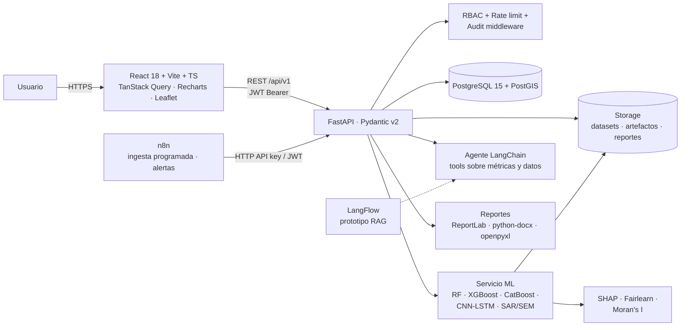
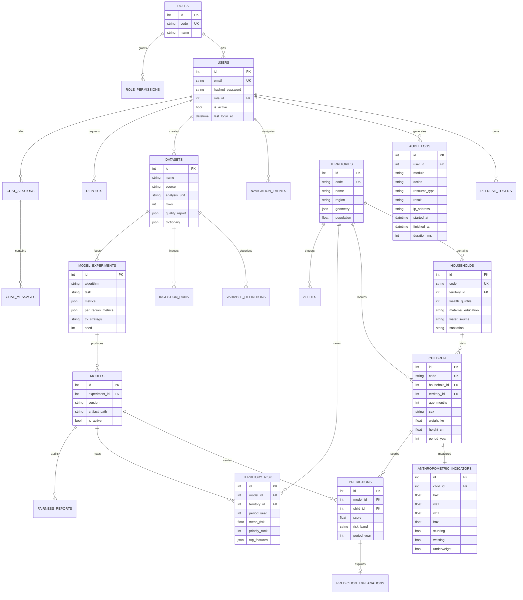
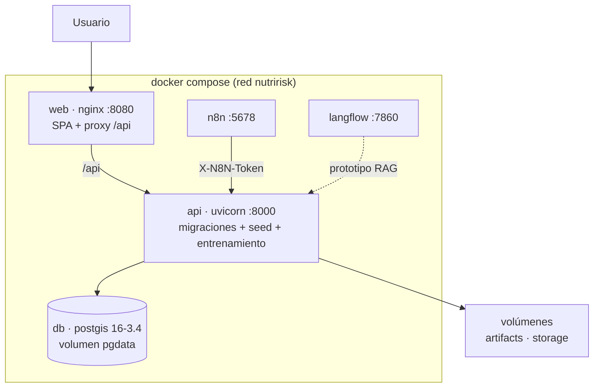

# Arquitectura y modelo de datos — NutriRisk AI

> Documento técnico. Código e identificadores en inglés; documentación en español.
> Los datos incluidos son **sintéticos** y están etiquetados como tales (`source=SYNTHETIC`).

## 1. Resumen de requisitos (≤ 15 líneas)

1. Predicción explicable de desnutrición infantil integrando determinantes socioeconómicos, nutricionales y ambientales.
2. Unidad de análisis configurable: niño, hogar o área geográfica.
3. Ingesta de datasets tipo DHS / World Bank / UNICEF / WorldPop con validación, diccionario y control de calidad.
4. Indicadores antropométricos OMS: HAZ, WAZ, WHZ, BAZ y clasificación stunting/wasting/underweight.
5. Modelos Random Forest, XGBoost y CatBoost (clasificación y regresión), más híbridos XGBoost+SAR/SEM y CNN-LSTM espaciotemporal.
6. Validación por regiones (GroupKFold / leave-one-region-out) para demostrar transferibilidad espacial.
7. Métricas AUC-ROC, F1, precision/recall, RMSE, MAE y Moran's I de residuos.
8. Explicabilidad SHAP global/local y análisis de equidad por sexo, quintil de riqueza, urbano/rural y región.
9. Cartografía de riesgo, ranking de territorios prioritarios e integración de capas WorldPop/ambientales.
10. Dashboard con KPIs, filtros, tendencias, comparativos y mapa interactivo.
11. Reportes PDF, Word y Excel, con programación automática vía n8n.
12. Autenticación JWT + refresh, roles Administrador/Científico/Analista/Gestor/Auditor y RBAC.
13. Bitácora inmutable con entrada/salida de módulo, filtros, búsqueda y exportación.
14. Agente conversacional LangChain, gestión de modelos/experimentos, catálogo de datasets, alertas, configuración y ayuda.
15. Seguridad, rendimiento, calidad (pytest ≥70 %, ruff, eslint), reproducibilidad y Docker Compose.

## 2. Vista de componentes



## 3. Modelo de datos (ER)



## 4. Estructura del monorepo

```
nutririsk-ai/
├── backend/
│   ├── app/
│   │   ├── api/v1/          # routers REST (auth, users, audit, datasets, ingestion,
│   │   │                    # indicators, experiments, models, xai, fairness, geo,
│   │   │                    # dashboard, reports, agent, alerts, settings, help)
│   │   ├── core/            # config, security, rbac, rate_limit, logging, errors
│   │   ├── db/              # base, session, bootstrap
│   │   ├── middleware/      # audit, security headers, rate limiting
│   │   ├── ml/              # features, training, spatial, cnn_lstm, registry
│   │   ├── models/          # entidades SQLAlchemy 2.x
│   │   ├── schemas/         # contratos Pydantic v2
│   │   ├── services/        # anthropometry, ingestion, modeling, xai, fairness,
│   │   │                    # spatial, reporting (pdf/docx/xlsx), agent, alerts
│   │   └── main.py
│   ├── alembic/             # migraciones (incluye triggers de inmutabilidad)
│   ├── scripts/             # seed, generate_synthetic, train_pipeline
│   ├── tests/               # pytest ≥ 70 %
│   └── requirements*.txt
├── frontend/                # React 18 + Vite + TS (TanStack Query, Recharts, Leaflet)
├── data/synthetic/          # CSV de demostración etiquetados SYNTHETIC
├── n8n/workflows/           # flujos exportados (.json)
├── langflow/                # flujo RAG exportado (.json)
├── notebooks/               # EDA reproducible
├── docs/                    # arquitectura, diccionario, manual
├── infra/                   # init SQL, nginx
├── docker-compose.yml
├── .env.example
├── README.md
├── DECISIONES.md
├── MANUAL_USUARIO.md
└── DICCIONARIO_DATOS.md
```

## 5. Flujo de datos

1. **Ingesta**: CSV/XLSX/Parquet → validación de esquema y tipos → control de calidad (nulos, outliers, duplicados) → normalización al modelo canónico (`children`, `households`, `territories`) → registro en catálogo con checksum SHA-256.
2. **Indicadores**: LMS OMS 2006 → z-scores y clasificaciones → `anthropometric_indicators`.
3. **Modelado**: tabla analítica → split por región → RF / XGBoost / CatBoost (+SAR/SEM, CNN-LSTM) → métricas globales y por región/subgrupo → artefacto versionado + registro en `model_experiments` / `models`.
4. **Explicabilidad**: SHAP (TreeExplainer) → importancia global, valores locales y agregación por territorio → `territory_risk.top_features`.
5. **Cartografía**: agregación por territorio y periodo → `territory_risk` con ranking y población en riesgo (WorldPop sintético) → GeoJSON servido a Leaflet.
6. **Consumo**: dashboard, reportes PDF/DOCX/XLSX, alertas n8n, agente LangChain.

## 6. Topología de despliegue



* **Arranque**: `entrypoint.sh` aplica `alembic upgrade head`, siembra datos (idempotente), entrena si no hay modelos
  (`SEED_TRAIN=true`), refresca explicaciones almacenadas e inicia uvicorn.
* **Salud**: `/health` y `HEALTHCHECK` del contenedor; el servicio `db` usa `pg_isready`.
* **Integración**: los flujos n8n llaman a endpoints autenticados con `X-N8N-Token`
  (`/ingestion/n8n/sync`, `/alerts/n8n/evaluate`, `/reports/n8n/generate`), que también quedan auditados.

## 7. Módulos de API y responsabilidades

| Router | Prefijo | Responsabilidad |
|---|---|---|
| auth | `/auth` | Login, refresh rotativo, logout, perfil, cambio y recuperación de contraseña |
| users | `/users` | CRUD de usuarios, roles y matriz de permisos (ADMIN) |
| audit | `/audit` | Bitácora inmutable, navegación, resumen y exportación triple formato |
| datasets | `/datasets` | Catálogo, carga, diccionario, calidad, vista previa y plantilla |
| ingestion | `/ingestion` | Historial, reproceso manual y sincronización programada (n8n) |
| indicators | `/indicators` | Z-scores OMS, prevalencias, distribución, referencia y recálculo |
| experiments | `/experiments` | Entrenamiento en segundo plano, comparación y métricas por región |
| models | `/models` | Registro, activación, puntuación y artefactos |
| xai | `/xai` | SHAP global, local, territorial y dependencia |
| fairness | `/fairness` | Métricas de equidad y recálculo con Fairlearn |
| geo | `/geo` | GeoJSON de riesgo, ranking, detalle territorial y capas |
| dashboard | `/dashboard` | KPIs, tendencias, comparativos y opciones de filtro |
| reports | `/reports` | Generación y descarga PDF/DOCX/XLSX (+ endpoint n8n) |
| alerts | `/alerts` | Reglas, reconocimiento, resolución y resumen |
| agent | `/agent` | Chat, sesiones y capacidades del agente LangChain |
| settings | `/settings` | Configuración agrupada y lectura pública |
| help | `/help` | Guías y FAQ |
| system | `/system` | Salud, información, monitoreo y regeneración de datos |

## 8. Decisiones clave

Las ambigüedades resueltas (motor de base de datos, SHAP en puntos porcentuales, protocolo del CNN-LSTM, token de n8n,
entre otras) están documentadas en [`DECISIONES.md`](../DECISIONES.md). El modelo se describe en
[`MODEL_CARD.md`](MODEL_CARD.md).
